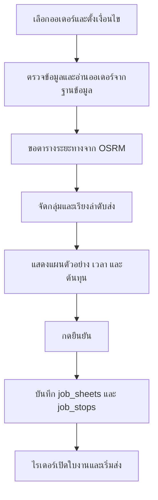

# ระบบทดสอบแบ่งงานและใบงานไรเดอร์

หน้า Angular อยู่ที่ `src/app/frontend/test-api` เปิดผ่านเส้นทาง `/test-api`

## เริ่มใช้งาน

ระบบใช้ `service/osrm.ts` ขอระยะทางตามถนนและเส้นทาง GeoJSON ด้วยโปรไฟล์ `driving`
ค่าเริ่มต้นเรียก `https://router.project-osrm.org` โดยไม่ต้องใช้ API key หากมีเซิร์ฟเวอร์ OSRM ของตนเอง ให้กำหนด `OSRM_BASE_URL` ใน `.env`

Backend:

```sh
npm run db:migrate
npm run dev
```

Frontend:

```sh
npm start
```

เปิด `http://localhost:4200/test-api` แล้วระบุ URL Backend เป็น `http://localhost:3000` โดยไม่เติม `/api`
หน้านี้เรียก Backend ที่กรอกโดยตรง จึงไม่ใช้ proxy ที่ชี้ไป Render ของหน้าหลัก หากรัน Angular ด้วยพอร์ตอื่น ให้เปิด `/test-api` ที่พอร์ตนั้น

Migration เพิ่มเฉพาะคอลัมน์ nullable ต่อไปนี้ โดยใช้ 4 ตารางเดิมและคงข้อจำกัดสถานะตาม CREATE.txt:

- `orders.delivery_address`: ที่อยู่จัดส่งที่คัดลอกตอนสร้างออเดอร์
- `orders.delivery_latitude` และ `orders.delivery_longitude`: พิกัดจัดส่งที่คัดลอกตอนสร้างออเดอร์
- `job_sheets.planning_data`: JSON เก็บเงื่อนไข ราคา พิกัด และรายละเอียดแผนตอนยืนยัน เพื่อให้ใบงานย้อนหลังไม่เปลี่ยนตามข้อมูลลูกค้าปัจจุบัน
- `job_sheets.started_at`: เวลาเริ่มงานจริง
- `job_sheets.completed_at`: เวลาส่งครบจริง
- `job_stops.delivered_at`: เวลาส่งจริงแต่ละออเดอร์

คำสั่ง `npm run db:migrate` ตรวจว่ามีคอลัมน์แล้วหรือไม่ จึงรันซ้ำได้ ไฟล์ SQL สำหรับฐานข้อมูลเดิมอยู่ใน `migrations/001-delivery-planning.sql` และ `migrations/002-order-delivery-location.sql`

## จุดส่งที่เก็บไว้ในออเดอร์

เปลี่ยน: ออเดอร์ปกติและออเดอร์จำลองคัดลอกที่อยู่และพิกัดจาก `customers` ลง `orders.delivery_*` ตอนสร้าง
การแก้ที่อยู่หรือพิกัดใน `customers` ภายหลังมีผลกับออเดอร์ที่สร้างใหม่ ส่วนออเดอร์เดิมยังใช้จุดส่งที่เก็บไว้
ชื่อและเบอร์โทรยังอ่านจากลูกค้าปัจจุบัน จึงยังใช้ `customer_id` และ JOIN กับ `customers`

- `POST /orders` คัดลอกจุดส่งด้วย `INSERT ... SELECT` ในคำสั่งเดียว และไม่ใช้พิกัดที่ส่งมาจาก client
- `POST /orders/simulated` คัดลอกจุดส่งจากชุดข้อมูลลูกค้าที่อ่านตอนเริ่มสร้างออเดอร์จำลอง
- API อ่านออเดอร์, ค้นหา, nearby, คำนวณแผน และเปิดใบงาน ใช้จุดส่งจากออเดอร์
- Response ยังคงชื่อ `address`, `latitude`, `longitude` ผ่าน SQL alias จึงใช้กับ UI เดิมได้
- แผนที่ยืนยันแล้วมีสำเนาใน `planning_data` อีกชั้น ใบงานเดิมที่มีสำเนานี้ยังใช้ข้อมูลเดิมได้

ก่อนเริ่มใช้โค้ดใหม่ต้องรัน `npm run db:migrate` เพื่อเพิ่มคอลัมน์และเติมช่องที่ว่างจากข้อมูลลูกค้าปัจจุบัน
การรันซ้ำจะไม่เขียนทับค่าที่เก็บแล้ว และไม่มีการย้อนใช้พิกัดลูกค้าปัจจุบันอัตโนมัติหากออเดอร์ขาดพิกัด
หากลูกค้าเคยเปลี่ยนพิกัดมาก่อน การเติมข้อมูลออเดอร์เก่าจากลูกค้าปัจจุบันไม่สามารถกู้พิกัด ณ วันสั่งซื้อได้

คอมเมนต์ `เปลี่ยน:` ในไฟล์ที่แก้ระบุจุดที่ปรับมาใช้สำเนาจุดส่ง

## Flow

1. เชื่อมต่อ Backend แล้วเลือกวันที่ ระบบแสดงเฉพาะออเดอร์ ACTIVE ที่ยังไม่มี job_stops หากวันปัจจุบันไม่มีออเดอร์ หน้าทดสอบเลือกวันที่ล่าสุดที่มีออเดอร์ให้
2. เลือก 1–30 ออเดอร์ กรอกพิกัดร้านหรือคลิกบนแผนที่
3. กดคำนวณแผน ระบบขอระยะทางทุกคู่จุดจาก OSRM Table ตรวจพื้นที่บริการ 3 กม. แล้วจัดงานทีละใบด้วย Greedy เลือกเพื่อนใกล้เคียงและรวมเมื่อคุ้มกว่าแยกส่งและส่งทัน
4. แต่ละใบงานมี 1–3 ออเดอร์ ครอบคลุมออเดอร์ทั้งหมดโดยไม่ซ้ำ ไม่สร้างตัวเลือกทุกกลุ่มหรือค้นหาย้อนกลับ จึงไม่รับประกันค่าส่งต่ำที่สุดทั้งแผน
5. ตรวจระยะทาง เวลา ต้นทุน กำไร และเส้นทางแยกสี ขอแผนอื่นเพื่อเปรียบเทียบได้ ถ้าไม่มีแผนอื่นจะคงแผนเดิมไว้
6. กดยืนยัน ระบบล็อกแถวออเดอร์และลูกค้า ตรวจข้อมูลเทียบกับตอนคำนวณ ตรวจการจัดซ้ำ แล้วบันทึกทุกใบงานและทุกจุดส่งใน transaction เดียว
7. ใบงานที่ยืนยันมีสถานะ ISSUED และ is_locked = 1 ออเดอร์ในใบงานแก้จำนวนหรือลบผ่าน Order API ไม่ได้
8. ไรเดอร์กรอก job_code เปิดใบงาน กดเริ่มงาน แล้วกดส่งสำเร็จตามลำดับ เมื่อส่งครบระบบบันทึก completed_at อัตโนมัติ

กำไรติดลบแสดงเตือน แต่ไม่ตัดออเดอร์ออกหรือรับประกันว่าจะสร้างกำไรได้ทุกกรณี
หากมีออเดอร์ที่ส่งไม่ทันหรือไม่มีเส้นทาง ระบบจะไม่ยืนยันแผนที่ส่งไม่ครบ

พื้นที่บริการอ้างอิงพิกัดร้านที่ส่งใน settings.origin ใช้ระยะทางตามถนนจาก OSRM หากออเดอร์ใดเกิน 3 กม. หรือไม่มีเส้นทางจากร้าน จะตอบ 422 พร้อม order_id, distance_km และเหตุผล โดยยังไม่สร้างใบงาน ผู้ใช้ต้องแก้ข้อมูลหรือเลือกออเดอร์ใหม่ ไม่มีการตัดออเดอร์ออกเงียบ ๆ
ระยะนี้ใช้ตรวจร้านถึงลูกค้าแต่ละราย ไม่จำกัดผลรวมระยะทางทั้งใบงานหรือระยะกลับร้าน

## ลำดับการเรียกใช้โค้ดสำหรับแบ่งงาน

OSRM ทำหน้าที่หาระยะทางตามถนนและเส้นทางสำหรับวาดแผนที่ ส่วน Backend ของเราเป็นคนจัดกลุ่มออเดอร์และเลือกลำดับส่ง
ปัจจุบันถือว่า **1 ใบงาน = งานของไรเดอร์ 1 คน** จำนวนไรเดอร์ในผลสรุปจึงเท่ากับจำนวนใบงาน ยังไม่มีการเลือกชื่อหรือบัญชีไรเดอร์รายบุคคล



### 1. โหลดออเดอร์ที่พร้อมจัดงาน

Frontend ใน `src/app/frontend/test-api/test-api.ts` เรียก `GET /job-sheets/eligible-orders?date=YYYY-MM-DD`
โดย [app.ts](../app.ts) ผูกเส้นทาง `/job-sheets` เข้ากับ [controller/job-sheet.ts](../controller/job-sheet.ts)

Controller เรียก `eligibleOrders()` ใน [service/job-store.ts](../service/job-store.ts) เพื่ออ่าน `orders` คู่กับ `customers`
โดยอ่านที่อยู่และพิกัดจาก `orders.delivery_*` ส่วนชื่อและเบอร์โทรจาก `customers`
เลือกเฉพาะออเดอร์วันที่กำหนด สถานะ `ACTIVE` และยังไม่มีรายการใน `job_stops`

### 2. กดคำนวณแผนจัดส่ง

Frontend ส่ง `POST /job-sheets/preview` พร้อมข้อมูลต่อไปนี้:

- `order_ids`: ID ของออเดอร์ที่เลือก 1–30 รายการ
- `settings`: พิกัดร้าน วันที่ เวลาออก กำหนดส่ง ความเร็ว เวลาส่งมอบ และอัตราค่าส่ง
- `previous_preview_id`: รหัส preview ปัจจุบันที่ต้องการแทนที่ ครั้งแรกไม่ต้องส่ง ใช้เมื่อขอแผนอื่นหรือแก้ชุดออเดอร์

Controller เป็นตัวประสานขั้นตอนต่อไปนี้ โดยยังไม่บันทึกใบงานลงฐานข้อมูล

### 3. ตรวจข้อมูลและเตรียมออเดอร์

Controller เรียก [service/planning-input.ts](../service/planning-input.ts):

- `readSettings()` ตรวจวันที่ เวลา พิกัด และค่าตัวเลข แล้วคืน `PlanningSettings`
- `readOrderIds()` ตรวจจำนวนรายการและ ID ซ้ำ แล้วคืน `number[]` ที่เรียงแล้ว

จากนั้นเรียก `selectedOrders()` ใน `service/job-store.ts` เพื่ออ่านออเดอร์จริงและตรวจว่าทุกรายการยังพร้อมจัดงาน
แล้วเรียก `normalizeOrders()` ใน `service/planning-input.ts` เพื่อตรวจพิกัด จำนวนกล่อง ราคา และแปลงข้อมูลจากฐานข้อมูลเป็น `PlanningOrder[]`
เช่น แปลงค่า DECIMAL ที่ฐานข้อมูลส่งมาเป็นข้อความให้เป็นตัวเลขสำหรับคำนวณ

### 4. ขอระยะทางตามถนนจาก OSRM

Controller เรียก `getDistanceMatrix([settings.origin, ...orders])` ใน [service/osrm.ts](../service/osrm.ts)
ฟังก์ชันนี้ขอข้อมูลจาก OSRM Table แล้วคืน `RoadMatrix` ซึ่งเป็นตารางระยะทางทุกคู่จุด หน่วยกิโลเมตร

- จุดลำดับ `0` คือร้าน จุดลำดับถัดไปตรงกับออเดอร์ใน `PlanningOrder[]`
- `matrix[0][1]` คือระยะร้านถึงออเดอร์แรก
- `matrix[1][2]` คือระยะออเดอร์แรกถึงออเดอร์ที่สอง
- ระยะ A→B อาจไม่เท่ากับ B→A และค่า `null` หมายถึงไม่มีเส้นทาง

ระยะทางชุดนี้เป็นข้อมูลให้ตัวแบ่งงานคำนวณ OSRM ไม่ได้เป็นคนแบ่งออเดอร์ให้เรา

### 5. จัดกลุ่มออเดอร์และเลือกลำดับส่งด้วย Greedy

Controller เรียก `createDeliveryPlan(orders, settings, matrix, previousJobs?)` ใน [service/delivery-planning.ts](../service/delivery-planning.ts)

1. `validateServiceArea()` ตรวจระยะร้านถึงลูกค้าแต่ละรายไม่เกิน 3 กม.
2. `buildGreedyJobs()` เริ่มจากหนึ่งออเดอร์ที่ยังไม่จัด แล้วเรียงออเดอร์ที่เหลือตามระยะจากจุดส่งสุดท้าย
3. ลองเพิ่มเพื่อนทีละราย โดยใช้ `permutations()` ลองลำดับของกลุ่มปัจจุบันเท่านั้น สูงสุด 3 ออเดอร์ / 6 ลำดับ
4. `buildJob()` คำนวณเวลาและค่าส่ง รับการรวมเมื่อส่งทันและค่าส่งต่ำกว่าค่าใบงานปัจจุบันรวมกับค่าส่งเดี่ยวของออเดอร์ที่จะเพิ่ม
5. ถ้าไม่คุ้มหรือส่งไม่ทัน ลองเพื่อนรายถัดไป ถ้าไม่มีที่ใช้ได้ให้จบใบงาน ไม่ฝืนรวมให้ครบ 3
6. จัดจนหมดรายการ แล้วรวมยอดส่งกลับ โดยทุกออเดอร์อยู่ในใบงานเดียวเท่านั้น

เวลาเดินทาง = ระยะทาง ÷ ความเร็ว × 60 นาที แล้วเพิ่มเวลาส่งมอบ ไม่ใช้เวลาประเมินของ OSRM โดยตรง
Greedy ไม่ได้ย้อนกลับมาเปลี่ยนใบงานที่จัดแล้ว จึงไม่รับประกันต้นทุนต่ำที่สุดทั้งแผน

เมื่อขอแผนอื่น จะสลับลำดับเริ่มจัดและลองไม่เกิน 10 ครั้งต่อคำขอ
`sameDeliveryJobs()` เทียบกลุ่มและลำดับส่งกับแผนปัจจุบันโดยตรง การสลับตำแหน่งการ์ดเฉย ๆ ไม่นับเป็นแผนใหม่
ถ้ายังเหมือนเดิมทุกครั้ง ตอบ 422 และคง preview เดิมไว้ ผู้ใช้กดลองใหม่ได้ ไม่มีประวัติหรือ hash signature

### 6. เก็บและแสดงแผนตัวอย่าง

Controller เรียก `rememberPreview(plan, orders)` ใน `service/job-store.ts` เพื่อเก็บแผนและข้อมูลออเดอร์ในหน่วยความจำ 30 นาที
แล้วส่ง `DeliveryPlan` พร้อม `preview_id` และ `expires_at` กลับไปให้ Frontend ตรวจสอบ ขั้นนี้ยังไม่มีการ INSERT ใบงาน

Frontend เรียก `POST /job-sheets/route` เพิ่มโดยส่งพิกัดร้านและจุดส่งตามลำดับของแต่ละใบงาน
Controller เรียก `getRoute()` ใน `service/osrm.ts` เพื่อขอเส้น GeoJSON เป็น `RouteLine` ให้ Frontend วาดบนแผนที่แยกสี
การขอตารางระยะทางกับการขอเส้นสำหรับวาดแผนที่จึงเป็นคนละคำขอ

หากกดเสนอแผนอื่น Frontend ส่ง `previous_preview_id` พร้อมออเดอร์และเงื่อนไขเดิม
Controller ใช้ `getPreview()` อ่านแผนปัจจุบันเพื่อเทียบกับผลใหม่
`rememberPreview(plan, orders, previousId)` เก็บแผนใหม่แล้วลบเฉพาะ preview ที่แทนที่ เมื่อสร้างสำเร็จเท่านั้น
หากขอแผนใหม่ล้มเหลว ไม่ลบของเดิม หากรหัสเก่าหมดอายุ/ถูกแทนที่/ยืนยันแล้ว ตอบ 409
ถ้าเปลี่ยนชุดออเดอร์หรือ settings จะจัดใหม่โดยไม่บังคับให้รูปแบบเส้นต่างจากเดิม แต่ยังลบ preview เก่าหลังสำเร็จ
ไม่มีการเก็บประวัติ แผน A → B → A เกิดขึ้นได้ ส่วน preview ของผู้ใช้อื่นยังอยู่ตามกติกาอายุและขนาด cache

### 7. ยืนยันและบันทึกใบงาน

Frontend เรียก `POST /job-sheets/confirm` พร้อม `preview_id` เพียงค่าเดียว
Controller เรียก `confirmPreview()` ใน `service/job-store.ts` เพื่ออ่านแผนที่ Backend เก็บไว้ แล้วดำเนินการใน transaction:

1. ตรวจว่าแผนยังไม่หมดอายุและยังไม่ถูกยืนยัน
2. ล็อกแถวออเดอร์และลูกค้าที่เกี่ยวข้องด้วย `FOR UPDATE`
3. ตรวจข้อมูลปัจจุบันเทียบกับตอนคำนวณ และตรวจว่าออเดอร์ยังไม่ถูกจัดงาน
4. สร้าง `job_code` แล้ว INSERT แต่ละใบงานลง `job_sheets` โดยตั้ง `status = 'ISSUED'` และ `is_locked = 1`
5. เก็บ `StoredPlanningData` เป็น JSON ใน `job_sheets.planning_data`
6. INSERT ออเดอร์ ลำดับส่ง และเวลาถึงโดยประมาณลง `job_stops`
7. Commit เมื่อสำเร็จทั้งหมด หรือ rollback ทั้งชุดหากขั้นใดล้มเหลว

เมื่อสำเร็จ Backend ลบแผนตัวอย่างที่ใช้แล้วออกจากหน่วยความจำ และส่งรายการ `job_id` กับ `job_code` กลับไป

รหัสใบงานใหม่ (`job_code`) เป็นตัวเลข 6 หลัก เช่น `482731` สร้างตอนยืนยันด้วย `randomInt(100000, 1000000)`
โดยไม่มีวันที่หรือคำนำหน้า เพื่อให้ไรเดอร์กรอกง่ายขึ้น วันที่จัดส่งยังเก็บแยกใน `delivery_date`
ฐานข้อมูลมี UNIQUE constraint ป้องกันรหัสซ้ำ หากสุ่มชนกับใบงานเดิมหรือคำขออื่น ระบบจะสุ่มใหม่ได้สูงสุด 10 ครั้ง
หากยังสร้างไม่ได้ จะ rollback ทั้งชุดและให้กดยืนยันอีกครั้ง ไม่มีการเขียนทับใบงานเดิม
ใบงานเก่ารูปแบบ `JOB-วันที่-ข้อความสุ่ม` ยังเปิดด้วยรหัสเดิมได้ ไม่ต้องแก้โครงสร้างฐานข้อมูล

### 8. ไรเดอร์เปิดใบงานและส่งอาหาร

ทุกเส้นทางเข้าทาง `controller/job-sheet.ts` แล้วเรียกฟังก์ชันใน `service/job-store.ts`:

| การทำงาน | API | ฟังก์ชัน |
|---|---|---|
| เปิดใบงานจากเลขใบงาน | `GET /job-sheets/by-code/:code` | `getJob()` |
| เริ่มงานและบันทึกเวลาจริง | `POST /job-sheets/by-code/:code/start` | `startJob()` |
| ส่งสำเร็จแต่ละจุดตามลำดับ | `POST /job-sheets/by-code/:code/stops/:stopId/deliver` | `deliverStop()` |

เมื่อส่งครบทุกจุด `deliverStop()` จะบันทึก `completed_at` ของใบงานอัตโนมัติ

## Interface และชนิดข้อมูลที่ใช้

Interface หลักอยู่ใน [model/delivery.ts](../model/delivery.ts):

| Interface | หน้าที่ |
|---|---|
| `PlanningOrder` | ออเดอร์พร้อมข้อมูลลูกค้า พิกัด จำนวนกล่อง ราคาขาย และต้นทุน โดยสืบทอดพิกัดจาก `Coordinates` |
| `PlanningSettings` | เงื่อนไขจัดงาน: วันที่ พิกัดร้าน เวลาออก กำหนดส่ง ความเร็ว เวลาส่งมอบ อัตราค่าส่ง และการกลับร้าน |
| `PlannedStop` | จุดส่งหนึ่งจุด มี `PlanningOrder` ลำดับส่ง ระยะจากจุดก่อนหน้า เวลาถึงและเวลาออกโดยประมาณ |
| `PlannedJob` | ใบงานหนึ่งใบ มี `PlannedStop[]` พร้อมยอดรวมจำนวนกล่อง ระยะ เวลา ค่าใช้จ่าย และกำไร |
| `DeliveryPlan` | แผนทั้งหมด มีเงื่อนไข `PlannedJob[]` ยอดรวมทุกใบงาน และวิธีจัดงานใน `method` |
| `StoredPlanningData` | เงื่อนไขและใบงานหนึ่งใบที่เก็บเป็น JSON ใน `job_sheets.planning_data` เพื่อเก็บข้อมูล ณ ตอนยืนยัน |

ความสัมพันธ์ของข้อมูล:

```text
DeliveryPlan
├─ settings: PlanningSettings
├─ jobs: PlannedJob[]
│  └─ stops: PlannedStop[]
│     └─ order: PlanningOrder
└─ summary: ยอดรวมทุกใบงาน

StoredPlanningData
├─ settings: PlanningSettings
└─ job: PlannedJob
```

ส่วน [service/osrm.ts](../service/osrm.ts) ประกาศด้วย `type`:

| Type | หน้าที่ |
|---|---|
| `Coordinates` | พิกัด `latitude` และ `longitude` |
| `RoadMatrix` | ตารางระยะทาง `(number \| null)[][]` หน่วยกิโลเมตร |
| `RouteLine` | เส้น GeoJSON แบบ `LineString` มีพิกัดเรียงเป็น `[longitude, latitude][]` |

Interface และ type ใช้กำหนดโครงสร้างข้อมูลให้ TypeScript ตรวจ ไม่ได้สร้างตารางหรือบันทึกข้อมูลเอง
ข้อมูลใบงานจะถูกบันทึกเมื่อ `confirmPreview()` เรียก SQL `INSERT` ตอนยืนยันเท่านั้น

## เวลาและค่าใช้จ่าย

- เวลาในใบงานแสดงและบันทึกเป็นเวลาไทย (Asia/Bangkok) ในคอลัมน์ DATETIME ส่วนวันที่ส่งใช้ YYYY-MM-DD
- ค่าเริ่มต้น: ออก 11:30 ส่งครบภายใน 12:30 ความเร็วคงที่ 30 กม./ชม.
- เวลาเดินทางแต่ละช่วง = ระยะทางตามถนน ÷ ความเร็ว × 60 นาที ไม่ใช้เวลาเดินทางที่ OSRM ประเมินโดยตรง จึงยังใช้ความเร็วตามโจทย์ 30 กม./ชม. ได้
- เพิ่มเวลาส่งมอบอาหารออเดอร์ละ 2 นาที กำหนดส่งตรวจถึงตอนส่งมอบเสร็จ รวมออเดอร์ที่ใช้พิกัดเดียวกันด้วย
- ค่าส่งต่อใบงาน = 15 + (2 × จำนวนกล่องทั้งหมดในใบงาน × ระยะทางรวมเป็นกม.) ปรับอัตราได้ในหน้า UI
- กำไร = ยอดขาย − ต้นทุนอาหาร − ค่าส่ง โดยใช้จำนวนกล่องและราคาจากออเดอร์จริง
- ค่าเริ่มต้นไม่กลับร้าน หากเลือกกลับร้าน จะรวมระยะทางและเวลากลับ แต่กำหนดส่งตรวจที่การส่งอาหาร ไม่บังคับกลับถึงร้านก่อนกำหนดส่ง
- เลข 3 จำกัดจำนวนออเดอร์ต่อใบงาน จึงอาจมีได้ถึง 9 กล่องต่อใบงาน

## API

| Method / เส้นทาง | หน้าที่ |
|---|---|
| GET /job-sheets/dates | วันที่มีออเดอร์และจำนวนที่พร้อมจัดงาน |
| GET /job-sheets/eligible-orders?date=YYYY-MM-DD | ออเดอร์พร้อมจัดงานของวันนั้น |
| POST /job-sheets/preview | คำนวณแผนตัวอย่าง ยังไม่เขียนใบงานลงฐานข้อมูล |
| POST /job-sheets/confirm | ยืนยันด้วย preview_id ที่ Backend ออกให้ |
| POST /job-sheets/route | ขอเส้นทาง GeoJSON จากพิกัด 2–5 จุดสำหรับแสดงบนแผนที่ |
| GET /job-sheets?date=YYYY-MM-DD | ใบงานและความคืบหน้าของวันที่เลือก |
| GET /job-sheets/by-code/:code | รายละเอียดใบงานพร้อมจุดส่งตามลำดับ |
| POST /job-sheets/by-code/:code/start | บันทึกเวลาเริ่มจริง รันซ้ำไม่เปลี่ยนเวลาเดิม |
| POST /job-sheets/by-code/:code/stops/:stopId/deliver | บันทึกเวลาส่งจริงตามลำดับ รันซ้ำไม่บันทึกซ้ำ |

ตัวอย่าง body สำหรับ preview:

```json
{
  "order_ids": [81, 82],
  "settings": {
    "delivery_date": "2026-10-05",
    "departure_time": "11:30",
    "deadline_time": "12:30",
    "origin": { "latitude": 16.25, "longitude": 103.25 },
    "speed_kmh": 30,
    "service_minutes": 2,
    "fixed_cost": 15,
    "cost_per_km_per_box": 2,
    "return_to_shop": false
  }
}
```

พิกัดและรหัสข้างต้นเป็นตัวอย่าง ต้องเปลี่ยนให้ตรงกับข้อมูลที่เลือก
ขอแผนอื่นโดยใส่ `previous_preview_id` ของแผนปัจจุบัน กดได้เรื่อย ๆ แต่แต่ละคำขอลองจัดใหม่สูงสุด 10 ครั้ง และอาจไม่พบแผนที่ต่าง
ยืนยันด้วย `{"preview_id":"ค่าที่ได้จาก preview"}` โดยไม่รับราคา ลำดับส่ง หรือผลคำนวณที่แก้จากฝั่งผู้ใช้

แผนตัวอย่างอยู่ในหน่วยความจำของ Backend มีอายุ 30 นาที เก็บได้สูงสุด 50 แผน หากรีสตาร์ต Backend หรือเปลี่ยนโปรเซสต้องคำนวณใหม่
ตารางระยะทางแคชไว้ 5 นาทีเพื่อลดคำขอซ้ำ ส่วน geometry ขอเมื่อแสดงแผนที่ หากโหลดเส้นไม่ได้จะแจ้งข้อผิดพลาด ไม่วาดเส้นตรงแทน

ตารางระยะทางรองรับร้านและออเดอร์สูงสุด 30 รายการ รวมไม่เกิน 31 จุด เส้นบนแผนที่ขอจาก OSRM Route ตามลำดับจุดในใบงาน
ปุ่มเปิดแผนที่นำทางใช้ Google Maps โหมด driving เส้นทางที่ Google Maps เลือกอาจต่างจาก OSRM ที่ใช้คำนวณใบงาน

เวลาเริ่ม/จบจริงแยกจากเวลาตามแผน สถานะหน้า UI คำนวณจาก started_at และ completed_at โดยสถานะฐานข้อมูลยังเป็น ISSUED ตาม CHECK constraint เดิม
ใบงานเดิมก่อนมี planning_data ยังเปิดดูข้อมูลปัจจุบันได้ แต่ไม่มี snapshot ต้นทุนและพิกัดร้านย้อนหลัง

## ตรวจสอบ

```sh
npm run typecheck
npm test -- test/delivery-planning.test.ts test/job-sheet.test.ts test/order-nearby.test.ts test/order-location.test.ts
```

ชุดข้างต้นจำลองฐานข้อมูลและบริการเส้นทาง ไม่แก้ข้อมูลจริง
สำหรับตรวจ MySQL และ OSRM จริงด้วย transaction ที่ rollback ทุกแถวทดสอบ (เลือกข้อมูลที่อยู่ในพื้นที่บริการ):

```sh
node scripts/smoke-planning.cjs
```

ตรวจการเก็บพิกัดออเดอร์กับ MySQL จริง: สร้างลูกค้าและออเดอร์ทดสอบ เปลี่ยนพิกัดลูกค้า
แล้วตรวจว่าออเดอร์เดิมไม่เปลี่ยน ออเดอร์ใหม่ใช้จุดใหม่ และยืนยันใบงานเดิมได้ โดย rollback ข้อมูลทดสอบทั้งหมด:

```sh
node scripts/smoke-order-location.cjs
```

ชุดทดสอบ Angular:

```sh
npm test -- --watch=false --include=src/app/frontend/test-api/test-api.spec.ts
```
